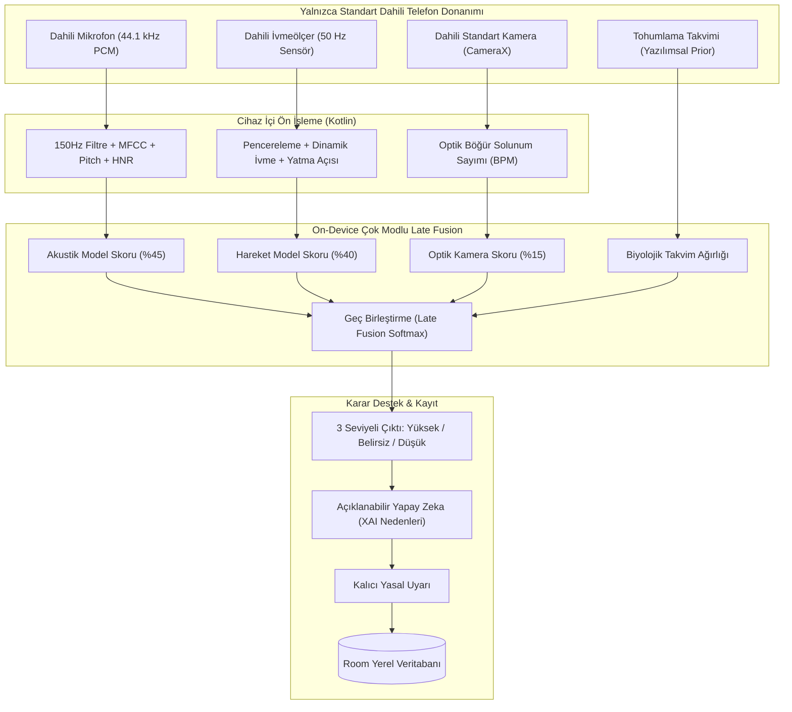

# OviScan: Koyun Gebelik Ön Tarama ve Karar Destek Sistemi 🐑📱

> **ÖNEMLİ YASAL UYARI:** Bu uygulama bir veteriner hekim teşhis cihazı **DEĞİLDİR**. Harici ultrason probu, laboratuvar kiti veya herhangi bir harici eklenti gerektirmeksizin, **yalnızca standart Android akıllı telefonun dahili donanımlarıyla** çalışan bir **risk sıralaması ve karar destek ön tarama aracıdır**. Kesin tanı için veteriner hekim muayenesi esastır.

---

## 1. Donanım Bağımsızlığı & Standart Android Özellikleri

Uygulama, piyasadaki standart ve giriş seviyesi dahil tüm Android cihazlarda (Android 8.0+) **hiçbir ilave donanım, prob veya dongle olmadan** çalışacak şekilde tasarlanmıştır:

| Telefonun Dahili Özelliği | Android API | Sistemdeki Kullanım Amacı | Harici Donanım İhtiyacı |
|---|---|---|---|
| **Dahili Mikrofon** | `AudioRecord` (44.1 kHz, 16-bit PCM Mono) | Rumen geviş getirme akustikleri, solunum ritmi ve östrus meleme patlamalarının analizi. (150 Hz yazılımsal gürültü filtresi + MFCC + Pitch + HNR). | **YOK (Sıfır)** |
| **Dahili İvmeölçer** | `SensorManager` (50 Hz `TYPE_ACCELEROMETER`) | 3-eksenli hareket ivmesi, aktivite indeksi, dinlenme ve yatma duruşu açısının takibi. | **YOK (Sıfır)** |
| **Dahili Kamera** | `CameraX` (Standart Arka Kamera) | Hayvanın böğür (karın) bölgesindeki optik parlaklık salınımından solunum frekansının (BPM) ve karın genişlik oranının temassız ölçümü. | **YOK (Sıfır)** |
| **Dahili İşlemci (CPU/NPU)** | TensorFlow Lite / Kotlin Runtime | Tüm makine öğrenmesi ve çok modlu Late Fusion çıkarımının **internet olmadan, cihaz üzerinde (offline)** çalıştırılması. | **YOK (Sıfır)** |
| **Dahili Bellek / Depolama** | Room / SQLite | Sürü kayıtları, ölçüm geçmişi ve veteriner doğrulama teyitlerinin yerel şifreli saklanması. | **YOK (Sıfır)** |

---

## 2. Biyolojik Karar Destek Mantığı (17 Günlük Östrus Siklusu)

1. **Östrus Dönüşü Olmaması (Non-Return to Estrus):**
   - Koyunların kızgınlık siklusu ortalama **16–17 gündür**.
   - Tohumlanan koyun gebe kalmamışsa, 17. gün ve 34. gün civarında tekrar kızgınlığa gelir; bu dönemde yüksek hareketlilik (koç arama, atlama) ve sık tiz meleme sergiler.
   - Gebe koyunda ise progesteron hormonu yüksek kalır, hareket deseni sakinleşir ve dinlenme/yatma oranı artar.
2. **Optik Solunum Değişimi:**
   - Gebe koyunlarda fötal oksijen gereksinimi ve metabolizma artışına bağlı olarak istirahat solunum frekansı artar (ortalama 26-36 BPM). Dahili kamera bunu optik piksel akışıyla temas etmeden yakalar.
3. **Akustik Ruminasyon Analizi:**
   - Hayvanın geviş getirme ve solunum akustikleri 150 Hz üzeri frekanslarda mikrofonla analiz edilerek huzursuzluk/östrus patlamalarından ayrıştırılır.

---

## 3. Sistem Mimarisi



---

## 4. Nasıl Test Edilir?

### A. Web Simülatöründe Hemen Test Edin
İlave hiçbir kurulum yapmadan, sistemin çalışma mantığını tarayıcınızda görmek için:
- [`docs/index.html`](file:///C:/Users/murat.erman/.gemini/antigravity/scratch/oviscan-android/docs/index.html) veya [`index.html`](file:///C:/Users/murat.erman/.gemini/antigravity/scratch/oviscan-android/index.html) dosyasını tarayıcınızda çift tıklayarak açabilirsiniz.
- Veya PowerShell ile yerel sunucuyu başlatabilirsiniz:
  ```powershell
  cd "C:\Users\murat.erman\.gemini\antigravity\scratch\oviscan-android"
  .\serve_demo.ps1
  ```

### B. Android Studio ile Mobil Cihazda Çalıştırma
1. **Android Studio**'yu açıp `Open` ile [`C:\Users\murat.erman\.gemini\antigravity\scratch\oviscan-android`](file:///C:/Users/murat.erman/.gemini/antigravity/scratch/oviscan-android) klasörünü seçiniz.
2. Gradle senkronizasyonundan sonra Android 8.0+ herhangi bir fiziksel telefonda çalıştırınız.
